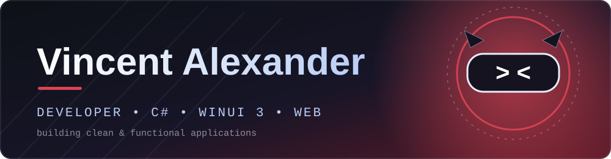
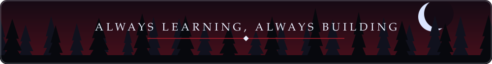

 

## ✠ About Me

I'm a developer who loves building **clean, functional applications**. I work mainly with C# and the web stack, and I'm currently exploring:

- 🪟 **WinUI 3** — modern Windows desktop apps
- 🤖 **Android development**
- 🔐 **Cybersecurity**

## ✠ Featured Projects

<table>
  <tr>
    <td width="33%" valign="top">
      <h3>🧹 <a href="https://github.com/GylaxDev/FlusherWeb">Flusher</a></h3>
      
A modern Windows system cleaning and optimization tool built with <b>WinUI 3</b>.

      
        ✦ Junk cleaning 
        ✦ Registry cleaning 
        ✦ Privacy traces removal 
        ✦ Disk analysis 
        ✦ Startup management
      
        
      
      
    </td>
    <td width="33%" valign="top">
      <h3>✅ <a href="https://github.com/GylaxDev/Tugaskan">Tugaskan</a></h3>
      
A simple and elegant to-do list web app. Add, complete, and manage your tasks with ease.

      
        ✦ Vanilla HTML, CSS &amp; JS 
        ✦ No frameworks 
        ✦ Deployed on Vercel
      
        
      <a href="https://tugaskan.vercel.app/"><b>🔗 Live Demo</b></a>
        
      
      
    </td>
    <td width="33%" valign="top">
      <h3>🏥 <a href="https://github.com/GylaxDev/A_252410103018_TASKPBO">Sistem Rumah Sakit</a></h3>
      
A hospital management system in C# demonstrating core OOP concepts.

      
        ✦ Inheritance 
        ✦ Polymorphism 
        ✦ Encapsulation
      
        
      
      
    </td>
  </tr>
</table>

## ✠ Tech Stack

**Languages**

**Frameworks & Platforms**

**Tools & Deployment**

## ✠ GitHub Stats

## ✠ Connect

  

